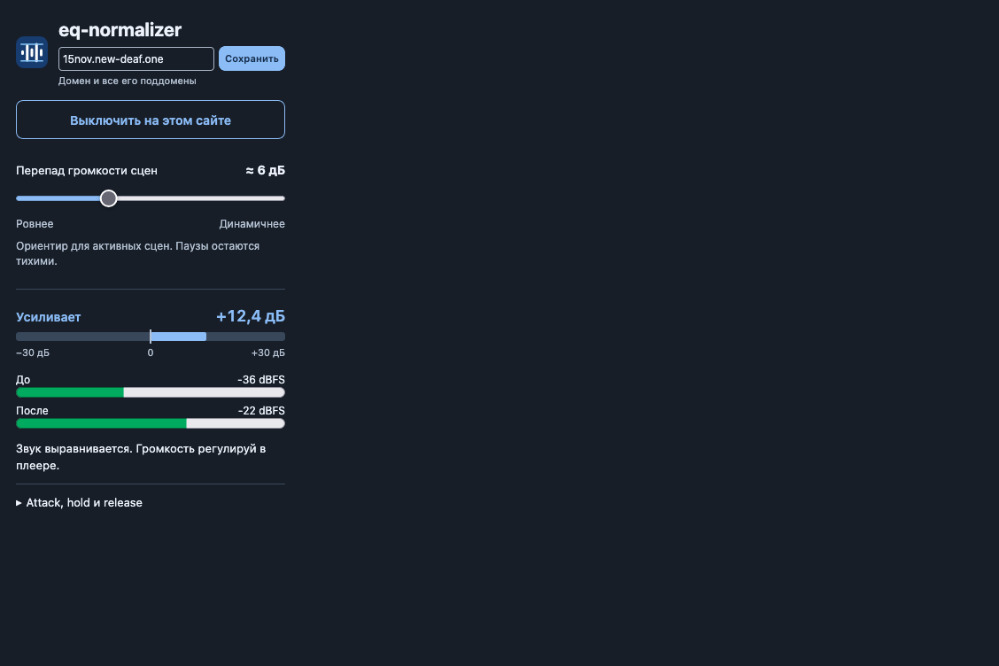

# eq-normalizer

Расширение выравнивает громкость фильмов. Тихие диалоги становятся слышнее, а громкие сцены звучат тише. Обработка идёт на устройстве и включается отдельно для каждого сайта.



## Установка

### Zen Browser и Firefox 142+

1. Скачай `eq-normalizer-0.2.0-zen.xpi` со страницы [релизов](https://github.com/zelebo/eq-normalizer/releases).
2. Для временной установки распакуй XPI как ZIP, открой `about:debugging#/runtime/this-firefox` → **Load Temporary Add-on…** и выбери распакованный `manifest.json`. Дополнение действует до перезапуска браузера.
3. В Zen, если браузер уже принимает неподписанные пакеты, можно установить XPI постоянно через `about:addons` → шестерёнка → **Установить дополнение из файла**. Для обычной постоянной установки в Firefox нужна подпись Mozilla.

### Search Browser

1. Скачай и распакуй `eq-normalizer-0.2.0-search.zip` со страницы [релизов](https://github.com/zelebo/eq-normalizer/releases).
2. Открой **Settings → Extensions → Load an unpacked extension → Choose…** и выбери папку с `manifest.json`.
3. Подтверди доступ к страницам и открытым вкладкам. Установка проверена в Search 1.0.20. Браузер показывал предупреждение, работу обработки звука в Search пока проверяем.

## Использование

Перезагрузи страницу с фильмом, открой eq-normalizer в меню расширений и нажми **Включить на этом сайте**. Запусти фильм. Когда расширение получит доступ к аудио, панель покажет статус **Звук выравнивается** и уровни до и после обработки.

Начальное значение составляет около 6 дБ. Двигай ползунок влево для более ровного звука или вправо для большего перепада сцен. Общую громкость регулируй в самом плеере. Существующий выбор диапазона при обновлении сохраняется.

Поле под названием расширения редактируется. Например, замени `15nov.new-deaf.one` на `new-deaf.one` и нажми «Сохранить»: правило будет работать для корневого домена и его датированных поддоменов. Можно выбрать текущий домен или его родительский домен. Настройки по-прежнему разделяются по протоколу и порту; более конкретный домен имеет приоритет. Изменение переносит выбранное правило на новый домен, сохраняя его значения.

В разделе «Attack, hold и release» задаются времена в миллисекундах. Начальные значения: attack 100 мс, hold 500 мс, release 1500 мс. Attack замедляет приглушение; hold удерживает усиление в короткой паузе и задерживает восстановление после громкой сцены; release задаёт плавность восстановления и возврата усиления к нулю в длинной паузе. Нажми «Применить время», чтобы обновить обработку без перезапуска плеера. Пиковый лимитер остаётся быстрым для защиты от перегрузки.

В меню расширения двусторонняя шкала показывает фактическое изменение громкости: вправо синим при усилении, влево оранжевым при приглушении. Рядом указаны действие и значение в дБ. Показания обновляются пять раз в секунду. В тишине шкала показывает удерживаемое усиление с меткой «Пауза», при выключении сбрасывается. Визуализация находится только в меню; на странице фильма её нет.

Локальный XPI можно собрать командой `npm run build`. Сборка появится в `dist/`. До версии 0.2.0 расширение называлось Night Leveler. Идентификатор дополнения сохранён для обновления с прежними настройками.

## Обработка звука

Расширение захватывает аудиодорожку `<video>` или `<audio>` через `captureStream()`. До получения доступного сигнала звучит оригинал. После проверки включается обработка в AudioWorklet; исходный выход плеера заглушается, а его регуляторы громкости и mute управляют обработанным выходом. Выключение, пауза, смена источника или ошибка возвращают исходный выход.

Компрессор измеряет RMS по обоим каналам и применяет к ним одинаковое усиление. Значение 6 дБ соответствует сжатию 6:1: установившиеся сигналы от −42 до −6 dBFS превращаются примерно в −23…−17 dBFS. Усиление ограничено +24 дБ. В короткой паузе оно удерживается на время hold, а затем плавно возвращается к нулю через release. Затухание RMS в паузе не создаёт дополнительного усиления. Пиковый лимитер использует 5 мс упреждения и потолок −1 dBFS.

Ползунок задаёт ориентир перепада активных сцен, а не строгий диапазон каждого отсчёта. Переходы, очень тихие сигналы и исходная фонограмма влияют на результат. Задержка включает 5 мс упреждения и буферы браузера; полная задержка на реальном фильме пока не измерена.

## Ограничения

- DRM и недоступное браузеру аудио с другого домена не обрабатываются. Расширение показывает ошибку и сохраняет исходный звук; ограничения защиты не обходит.
- Обрабатываются HTML-плееры, включая iframe. Звук игр, синтезаторов и других Web Audio-графов страницы не захватывается.
- Плеер, который переопределяет собственное свойство `muted`, получает явное сообщение о несовместимости. Для возврата звука при исчезновении моста расширения предусмотрена проверка его активности.
- Совместимость с конкретным плеером `new-deaf.one` и субъективное качество на фильме требуют проверки в обычном просмотре.

## Приватность и разрешения

Расширение не отправляет звук, настройки или статистику на сервер. Внешних библиотек и сетевых сервисов нет. В локальном хранилище остаются только адрес сайта, включение и значение ползунка.

Доступ к HTTP/HTTPS-страницам нужен для поиска плееров, в том числе во встроенных фреймах. `tabs` нужен для определения сайта активной вкладки и настройки его открытых вкладок; `webNavigation` нужен для адресации фреймов и очистки их статусов. На новом сайте обработка по умолчанию выключена.

## Проверки и сборка

Рабочие зависимости не нужны. Для проверок требуются Node.js 22+ и Python 3 для сборки.

```sh
npm test
npm run check
npm run build
```

Для браузерного теста задай `ZEN_BINARY` с путём к исполняемому файлу Zen и запусти `npm run test:browser`. Тест создаёт отдельный временный профиль, поднимает локальный HTTP-сервер и сохраняет снимок панели в `dist/popup-preview.png`.

Тесты DSP проверяют сжатие установившихся сцен, защиту пиков, отсутствие резкого сброса усиления в паузе и влияние attack/hold/release. Тесты правил домена проверяют датированные поддомены, сохранение существующих значений и границы домена. Снимок панели использует тестовые показания, а не измерения фильма на `new-deaf.one`.

Постоянная установка XPI проверена отдельно: после закрытия и повторного запуска Zen в том же тестовом профиле дополнение осталось активным (`isActive=true`, `appDisabled=false`, `temporarilyInstalled=false`).

Для проверки требований Mozilla можно отдельно запустить:

```sh
npx web-ext lint --source-dir extension --warnings-as-errors
```

Документация API: [захват аудио из плеера](https://developer.mozilla.org/en-US/docs/Web/API/HTMLMediaElement/captureStream), [правила захвата и громкости](https://w3c.github.io/mediacapture-fromelement/), [content scripts](https://developer.mozilla.org/en-US/docs/Mozilla/Add-ons/WebExtensions/manifest.json/content_scripts).
